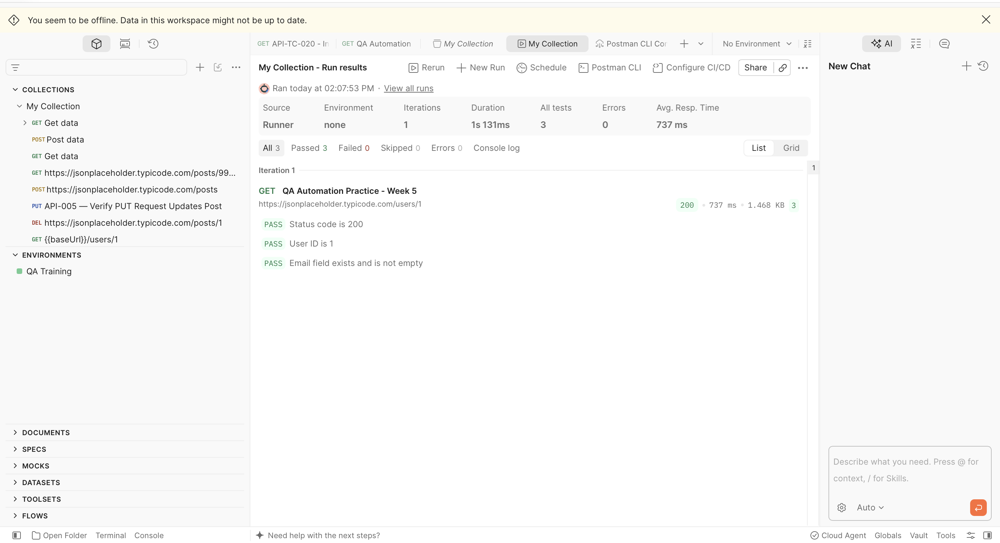

# API-TC-026 — GET User Validation

## Test Information

- Test Case ID: API-TC-026
- Test Type: Automated API Testing
- Tool: Postman
- HTTP Method: GET
- Endpoint: https://jsonplaceholder.typicode.com/users/1
- Execution Method: Postman Collection Runner
- Status: PASS

## Test Objective

Verify that the GET /users/1 API endpoint returns
HTTP 200 and valid user information.

## Automated Assertions

1. HTTP status code equals 200.
2. User ID equals 1.
3. Email field exists and is not empty.

## Postman Test Script

```javascript
pm.test("Status code is 200", function () {
    pm.response.to.have.status(200);
});

pm.test("User ID is 1", function () {
    const responseJson = pm.response.json();
    pm.expect(responseJson.id).to.eql(1);
});

pm.test("Email field exists and is not empty", function () {
    const responseJson = pm.response.json();
    pm.expect(responseJson).to.have.property("email");
    pm.expect(responseJson.email).to.be.a("string").and.not.empty;
});
```

## Execution Results

- Requests Executed: 1
- Total Assertions: 3
- Passed: 3
- Failed: 0
- HTTP Response: 200 OK
- Final Result: PASS

## Test Evidence



## Jira Documentation

The test case was documented in Jira with
execution results and screenshot evidence.

Jira Task Status: Done

## Conclusion

All three automated assertions passed successfully.
The tested API response met the defined validation
criteria during this execution.
