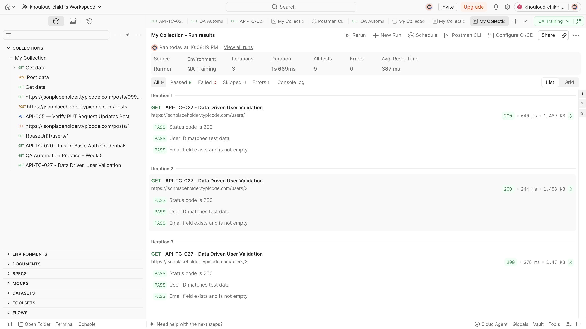

# API-TC-027 — Data-Driven User Validation

## 1. Test Overview

| Field | Details |
|---|---|
| Test Case ID | API-TC-027 |
| Test Type | Automated Functional API Testing |
| Testing Technique | Data-Driven Testing |
| Tool | Postman |
| Method | GET |
| Environment | QA Training |
| Execution Date | 24 November 2026 |
| Final Status | PASS |

## 2. Test Objective

Verify that the API returns the expected user information for multiple user IDs using a single reusable automated request.

## 3. API Endpoint

GET https://jsonplaceholder.typicode.com/users/{{userId}}

## 4. Test Data

| Iteration | User ID | Expected Status |
|---|---|---|
| 1 | 1 | 200 OK |
| 2 | 2 | 200 OK |
| 3 | 3 | 200 OK |

A JavaScript array was used as an alternative to CSV import due to Postman subscription limitations.

## 5. Pre-request Script

```javascript
const userIds = [1, 2, 3];

const currentUserId = userIds[pm.info.iteration];

pm.variables.set("userId", currentUserId);
```

This script dynamically assigns a different user ID during each iteration.

## 6. Post-response Script

```javascript
pm.test("Status code is 200", function () {
    pm.response.to.have.status(200);
});

pm.test("User ID matches test data", function () {
    const responseJson = pm.response.json();
    const expectedId = Number(pm.variables.get("userId"));
    pm.expect(responseJson.id).to.eql(expectedId);
});

pm.test("Email field exists and is not empty", function () {
    const responseJson = pm.response.json();
    pm.expect(responseJson).to.have.property("email");
    pm.expect(responseJson.email).to.be.a("string").and.not.empty;
});
```

## 7. Test Execution Results

| Validation | User 1 | User 2 | User 3 |
|---|---|---|---|
| HTTP status code 200 | PASS | PASS | PASS |
| User ID validation | PASS | PASS | PASS |
| Email field validation | PASS | PASS | PASS |

### Execution Summary

| Metric | Result |
|---|---|
| Total iterations | 3 |
| Total assertions | 9 |
| Passed | 9 |
| Failed | 0 |
| Skipped | 0 |
| Errors | 0 |
| Pass rate | 100% |
| Average response time | 387 ms |
| Total execution duration | 1.669 seconds |

## 8. Test Evidence



## 9. Jira Documentation

- Issue type: Task
- Test execution report: Completed
- Test evidence: Attached
- Jira status: Done

## 10. Skills Demonstrated

- Functional API testing
- Data-driven testing
- JavaScript assertions
- Dynamic variable management
- Postman Collection Runner
- JSON response validation
- Test execution reporting
- Jira documentation
- GitHub portfolio management
- Troubleshooting test configuration issues

## 11. Conclusion

All nine automated assertions passed across three iterations.

The data-driven testing approach improved test reusability and reduced repetitive manual execution.

No defects were identified within the scope of this test execution.

**Final Test Result: PASS**
