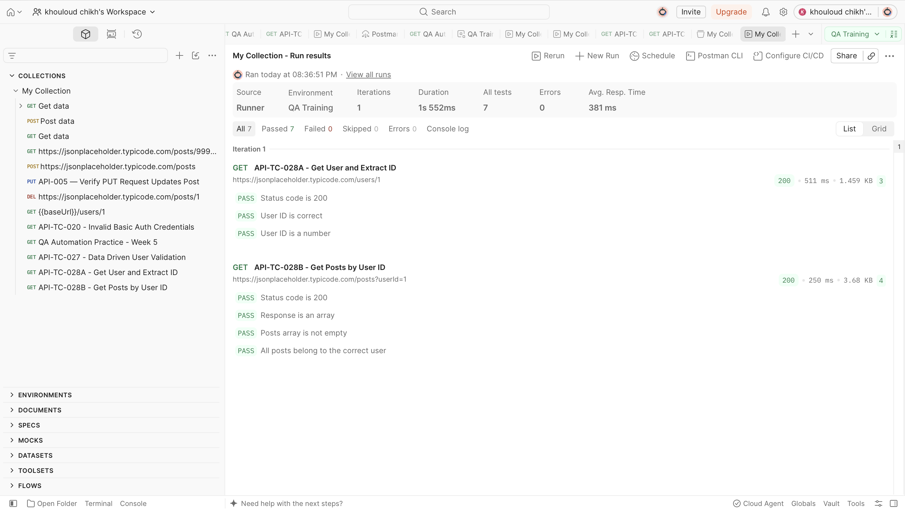

# API-TC-028 — Automated API Request Chaining

## Objective

Validate automated request chaining by extracting a user ID
from one API response and dynamically reusing it in a
subsequent request.

## Tools and Technologies

- Postman
- JavaScript
- REST API
- JSON
- Collection Runner
- Environment Variables
- Jira

## API Under Test

Base URL: https://jsonplaceholder.typicode.com

## Request A — Get User and Extract ID

Method: GET

Endpoint: /users/1

Automated assertions:

- HTTP status code is 200.
- User ID equals 1.
- User ID is a number.

Extracted environment variable: chainedUserId

Result: 3/3 PASS

## Request B — Get Posts by User ID

Method: GET

Endpoint: /posts?userId={{chainedUserId}}

Automated assertions:

- HTTP status code is 200.
- Response is an array.
- Posts array is not empty.
- All posts belong to the extracted user ID.

Result: 4/4 PASS

## Request Chaining Workflow

1. Retrieve user information.
2. Extract the user ID from the JSON response.
3. Store the ID in an environment variable.
4. Dynamically reuse the ID in the second request.
5. Validate the returned posts.
6. Execute both requests sequentially in Collection Runner.

## Execution Results

| Metric | Result |
|---|---|
| Requests | 2 |
| Total assertions | 7 |
| Passed assertions | 7 |
| Failed assertions | 0 |
| Pass rate | 100% |
| Final status | PASS |

## Troubleshooting

The initial collection execution reported only four
passing assertions. The missing test execution in the
first request was corrected, and the collection was
successfully executed again.

## Skills Demonstrated

- Automated API request chaining
- Dynamic environment variables
- JSON response parsing
- JavaScript assertions
- Array iteration using forEach()
- Data integrity validation
- Collection Runner execution
- Test troubleshooting
- Professional test documentation

## Test Evidence

## Conclusion

Both API requests were successfully executed with
seven passing automated assertions, demonstrating
successful request chaining and data integrity validation.
