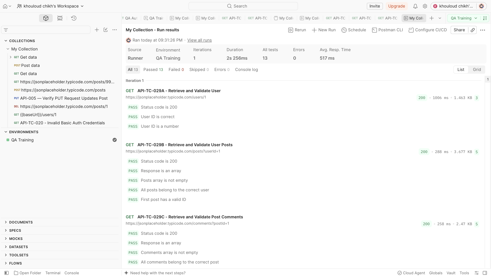
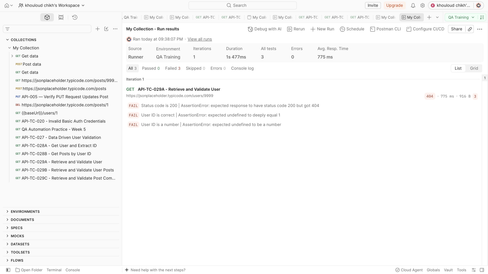

# API-TC-029 — Automated End-to-End API Workflow

## Objective

Validate a complete read-only API workflow using
dynamic request chaining, automated assertions,
data integrity validation and automatic failure handling.

## Tools and Technologies

- Postman
- JavaScript
- REST API
- JSON
- Collection Runner
- Environment Variables
- Jira
- GitHub

## API Under Test

Base URL: https://jsonplaceholder.typicode.com

Environment: QA Training

## Workflow Architecture

User Retrieval
    ↓
Extract workflowUserId
    ↓
User Posts Retrieval
    ↓
Extract workflowPostId
    ↓
Post Comments Retrieval
    ↓
Final Validation

## Request A — Retrieve and Validate User

Method: GET

Endpoint: /users/1

Assertions:

- HTTP status code is 200.
- User ID equals 1.
- User ID is a number.

Extracted variable: workflowUserId

Result: 3/3 PASS

## Request B — Retrieve and Validate User Posts

Method: GET

Endpoint: /posts?userId={{workflowUserId}}

Assertions:

- HTTP status code is 200.
- Response is an array.
- Posts array is not empty.
- All posts belong to the correct user.
- First post has a valid integer ID.

Extracted variable: workflowPostId

Result: 5/5 PASS

## Request C — Retrieve and Validate Post Comments

Method: GET

Endpoint: /comments?postId={{workflowPostId}}

Assertions:

- HTTP status code is 200.
- Response is an array.
- Comments array is not empty.
- All comments belong to the correct post.
- All comment email formats are valid.

Result: 5/5 PASS

## Automated Failure Handling

The workflow uses conditional execution to prevent
dependent requests from running when required
response validations fail.

Key techniques:

- try...catch for safe JSON parsing
- if...else for conditional execution
- pm.environment.unset() for variable cleanup
- pm.environment.set() for dynamic data extraction
- pm.execution.setNextRequest(null) for termination

## Scenario 1 — Positive Workflow

| Metric | Result |
|---|---|
| Requests executed | 3 |
| Total assertions | 13 |
| Passed assertions | 13 |
| Failed assertions | 0 |
| Errors | 0 |
| Pass rate | 100% |
| Scenario status | PASS |

## Scenario 2 — Negative Workflow

Test data: Invalid user ID 9999

Endpoint: /users/9999

Expected behaviour:

- Request A returns HTTP 404.
- Required assertions fail.
- Workflow terminates automatically.
- Requests B and C are not executed.

| Metric | Result |
|---|---|
| HTTP status | 404 |
| Requests executed | 1 |
| Expected assertion failures | 3 |
| Script errors | 0 |
| Dependent requests not executed | 2 |
| Automatic termination | Successful |
| Scenario status | PASS |

The assertion failures were intentional.
The negative scenario passed because the workflow
stopped as expected.

## Recovery Validation

The original endpoint was restored to /users/1.

The complete workflow was executed again with
13/13 passing assertions.

## Skills Demonstrated

- End-to-end API workflow testing
- Automated request chaining
- Dynamic environment variables
- JavaScript assertions
- Exception handling
- Conditional execution
- Fail-fast behaviour
- Data integrity validation
- Regular expression validation
- Positive and negative testing
- Collection Runner execution
- Professional test documentation

## Test Evidence

### Positive Workflow

### Negative Workflow

## Test Scope and Limitations

This exercise uses a public mock REST API and
a read-only workflow.

Automatic termination was tested at Request A.
Failure handling at Request B was implemented
but not independently tested.

## Conclusion

Both positive and negative workflow scenarios
passed successfully, demonstrating automated API
validation, request dependencies and controlled
workflow termination.

Final Test Status: PASS
